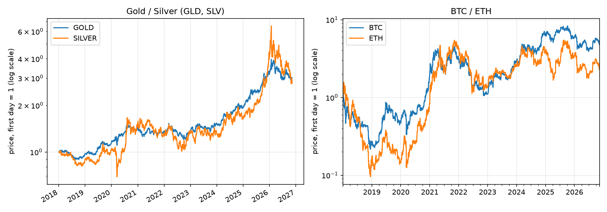
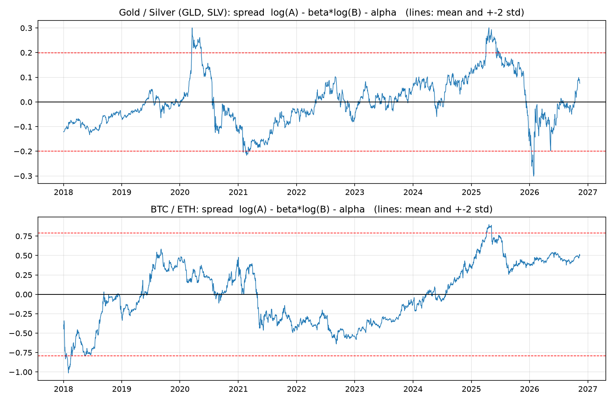
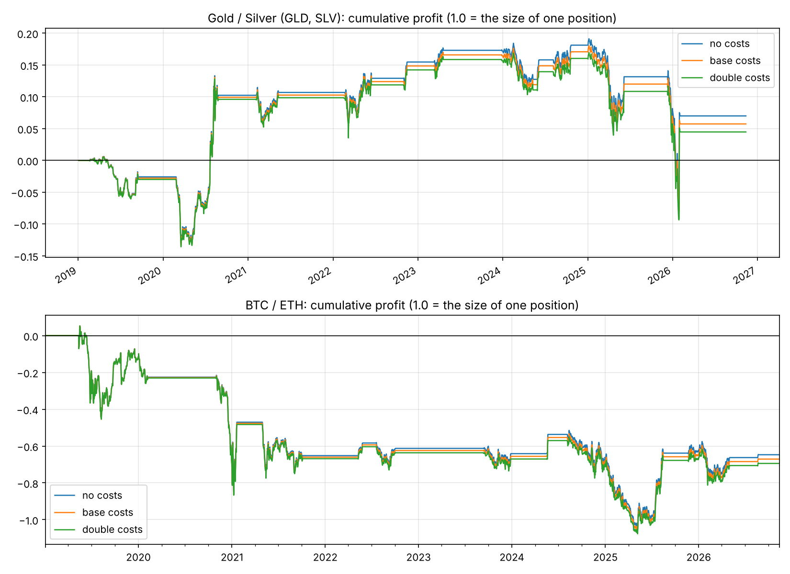
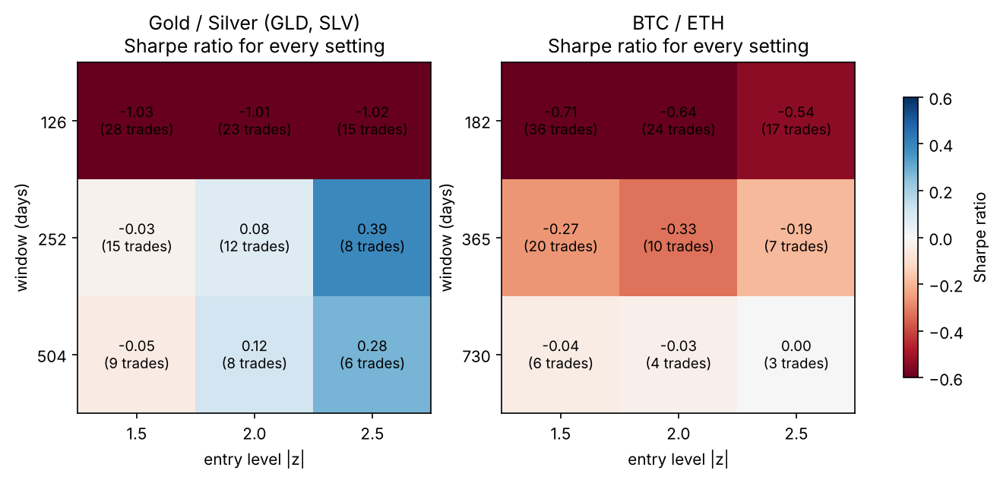
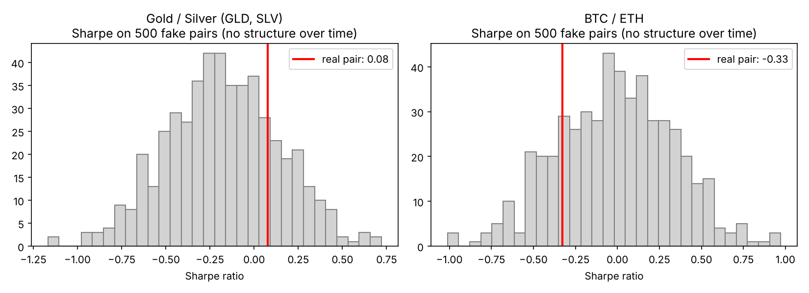

# Pairs trading on gold/silver and BTC/ETH: a walk-forward test with robustness checks

**Question.** Do gold and silver (and Bitcoin and Ethereum) have a stable long-run
relationship, so that the spread between them reliably returns to its mean? And if so,
can a simple pairs-trading rule profit from it after trading costs?

**Short answer.** For these two pairs, over 2018 to 2026, and with this simple rule, I found
**no evidence of an exploitable edge**. Gold/silver is borderline in the statistical tests
and earns almost nothing in the backtest. BTC/ETH shows no mean reversion and loses money.
The result is a careful negative result, not a trading signal.

| | Gold / Silver (GLD, SLV) | BTC / ETH |
|---|---|---|
| Engle-Granger cointegration p-value | 0.098 | 0.321 |
| Half-life of the spread | 98 days | 564 days |
| Backtest Sharpe ratio (after costs) | 0.08 | -0.33 |
| 95 % bootstrap interval for the Sharpe ratio | -0.65 to 0.73 | -1.06 to 0.34 |
| Share of fake pairs (no structure over time) doing at least as well | 21 % | 80 % |

## Data

Daily closing prices from Yahoo Finance (via `yfinance`, adjusted): the ETFs GLD (gold) and
SLV (silver), and BTC-USD and ETH-USD. The window is fixed: **2018-01-02 to 2026-11-12**
(the file was downloaded on 2026-11-14; the incomplete last days were dropped). Metals trade on
weekdays only and crypto every day, so each pair is cleaned separately (only days on which both
assets have a price). The downloaded snapshot is included for reproducibility; please check
Yahoo's terms before reusing it. GLD and SLV are used instead of futures because futures
contracts expire and their price history has jumps at the roll.

## Method

**1. Do the two assets move together in the long run?** (`src/explore.py`)
Log prices; ADF unit-root test on each price; hedge ratio from `log A = alpha + beta log B`;
Engle-Granger cointegration test; half-life of the spread from an AR(1) fit; and the same
analysis separately for every calendar year.

| | Gold / Silver | BTC / ETH |
|---|---|---|
| ADF p-value of each log price (non-stationary if high) | 0.94 and 0.85 | 0.81 and 0.71 |
| Engle-Granger statistic (5 % critical value about -3.34) | -3.05 | -2.41 |
| Years with cointegration at 5 %, out of 9 | 0 | 0 |
| Hedge ratio by year | 0.18 to 0.83 | 0.29 to 1.48 |

Daily returns are strongly correlated (0.66 to 0.91 by year), but the spread wanders for long
periods and the hedge ratio is unstable.




**2. Walk-forward backtest** (`src/backtest.py`, `src/run_backtest.py`)
Rules fixed before looking at any result:
- every day, fit the hedge ratio on the previous year (252 days for metals, 365 for crypto)
  and compute the z-score of today's spread;
- enter when |z| > 2 (short the spread if z is high, long if low), exit when |z| < 0.5;
- trade at the close of the day after the signal; costs of 5 basis points per trade for
  metals and 10 for crypto;
- each position has gross size 1 and profits are not reinvested, so a profit of 0.30 means 30 %
  of the size of one position.

| | Gold / Silver | BTC / ETH |
|---|---|---|
| Net profit | +0.057 | -0.671 |
| Sharpe ratio | 0.08 | -0.33 |
| Maximum drawdown | -0.26 | -1.11 |
| Trades (win rate) | 12 (67 %) | 10 (30 %) |
| Average trade length | 61 days | 126 days |

Costs are not the problem (profit before and after costs is almost the same): the signal itself
has no edge. For gold/silver, one trade (February to August 2020) produced +0.13; without it
the net result would be about -0.07.



**3. Robustness** (`src/robustness.py`, `src/run_robustness.py`)
- *Sensitivity:* 3 window lengths x 3 entry levels, all reported. Short windows lose heavily
  (Sharpe about -1.0 for gold/silver with 126 days); long windows give about zero. The few
  positive cells have only 6 to 8 trades.
- *Bootstrap:* 95 % interval for the Sharpe ratio using blocks of 20 days (see the table above);
  both intervals contain zero.
- *Permutation test:* the same strategy is run on 500 fake pairs made of the same daily returns
  in random order (same correlation and return distribution, no structure over time). 21 % of
  them do at least as well as gold/silver and 80 % as well as BTC/ETH.
- *Selection bias:* the best of the 9 settings for gold/silver (Sharpe 0.39) is no better than
  what the best of 9 gives on fake pairs (p = 0.27).




## Limitations

- Very few trades (12 and 10), so the tests have little power. "No evidence of an edge" is not
  proof that none exists.
- The backtest is optimistic: borrowing and funding of the short leg are free, trades happen at
  the close, and costs are constant. Real results would be worse.
- Two pairs, one rule, one period, and ETFs instead of spot or futures prices.
- The permutation test checks "no structure over time"; it keeps return correlation and
  distribution but not volatility clustering.
- Nothing here is investment advice.

## Reproduce

```bash
pip install -r requirements.txt
python src/download_data.py        # optional: a snapshot of the prices is included
python src/explore.py              # stage 2: tests and figures
python src/run_backtest.py         # stage 3: backtest
python src/run_robustness.py       # stage 4: sensitivity, bootstrap, permutation test (1 to 3 minutes)
python tests/test_stage2.py
python tests/test_backtest.py
python tests/test_robustness.py
```

## Layout

```
data/prices.csv                       daily prices (snapshot of 2026-11-14)
src/download_data.py                  download the prices
src/data.py  pairs.py  stats_tests.py loading, hedge ratio / spread / half-life, ADF and Engle-Granger
src/explore.py                        stage 2
src/backtest.py  run_backtest.py      stage 3
src/robustness.py  run_robustness.py  stage 4
tests/                                automated checks, including a no-look-ahead test
results/                              tables (csv) and figures (png)
```

## About

Python (numpy, pandas, SciPy, statsmodels, matplotlib). Developed with the help of an AI
assistant (Claude); all results were re-run and checked by the author.

Author: **<Maryam Zarghami>**
